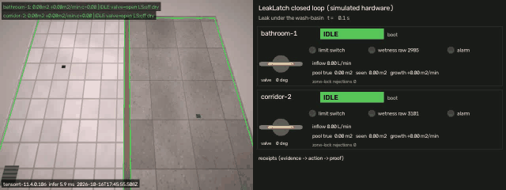
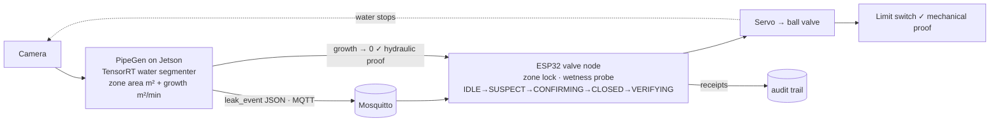

# LeakLatch 💧🔒

**Zone-locked evidence-to-action chain for water leaks in PGs and hostels.**
A camera sees water pooling and measures how fast it grows. A ₹2,000 ESP32 node at the valve double-checks
with a floor probe, shuts off that zone's water, proves the valve moved with a limit switch, and proves
with the camera that the leak stopped.

> CraftifAI Physical AI Hackathon: **Track A PipeGen** (edge vision → TensorRT → MQTT) +
> **Track B FirmGen** (ESP-IDF v5.5 valve node) + **closed-loop bonus** (perception → action → verification).
> Requirement-by-requirement evidence: [SUBMISSION.md](SUBMISSION.md).



## Why

Indian PG and hostel operators find leaks late, usually when the floor below complains or the water bill
arrives. A burst flexible hose or cracked joint wastes litres per minute and soaks wiring and furniture.
Commercial shut-off systems are whole-house, so one leak cuts water for 40 residents, and their
probe-only triggers fire on every mopped floor. LeakLatch shuts **one zone**, and only when **two independent
senses** agree.

## How it works



| Link | Proof |
|---|---|
| Camera sees a pool **in this zone** | `leak_event` with `event_id, zone_id, timestamp, confidence, pool_area (m²), growth_rate (m²/min)` + snapshot SHA-256 |
| Local probe agrees for 3 s | receipt `CONFIRMING → CLOSED (confirmed)` |
| Valve really moved | limit switch → receipt `CLOSED → VERIFYING (limit_switch)`; otherwise retry → `FAULT valve_not_closed` |
| Leak really stopped | camera growth ≤ 0.02 m²/min for 5 s → `VERIFYING → LATCHED (verified)`; otherwise `FAULT leak_persists` |

Details: [docs/architecture.md](docs/architecture.md) · [docs/mqtt-contract.md](docs/mqtt-contract.md) ·
[docs/hardware.md](docs/hardware.md) · [firmgen/README.md](firmgen/README.md)

## Results

### Perception (Track A)

| | |
|---|---|
| Model | LR-ASPP MobileNetV3-Large, 3.2 M params, 320×320, 1 class (water), BSD-3 torchvision. [Model card](models/MODEL_CARD.md) |
| Real held-out (263 Indian outdoor puddle images, coarse box-derived masks) | mask IoU **0.71**, image-level precision / recall **0.98 / 0.99** |
| Synthetic indoor held-out (400 tiled floors, 136 dry with reflections/shadows) | mask IoU **0.91**, image-level precision / recall **0.97 / 0.98** |
| **TensorRT** 11.4, FP16 engine, RTX 5070 Ti Laptop | **1.40 ms p50 / 3.08 ms p99**, ~634 FPS (ONNX Runtime CPU: 4.2 ms) |
| Engine vs FP32 ONNX on 80 real images | max probability diff 0.019, mask agreement IoU **0.997** |
| Pool-area accuracy (perspective-corrected) | within 6 % on a far-field 0.5 m² target; the naive pixel constant under-counts by about 30 % |

`models/trt_report.json`, `models/eval_metrics.json`, `models/onnx_export.json`

### Closed loop: TensorRT model in the loop, the real C state machine, every message schema-checked

| Scenario | Story | Leak at (s) | Vision detect (s) | Valve closed (s) | Outcome | Water lost | |
|---|---|---|---|---|---|---|---|
| `leak` | Leak under the wash-basin, then fixed and reset | 4.0 | 6.9 | 18.4 | LATCHED `verified` at 33.9 s → **IDLE** `operator_reset` | 0.37 L | ✅ |
| `zone-lock` | Corridor leak; the bathroom node rejects 36 foreign events | 4.0 | 9.7 | 20.9 | **LATCHED** `verified` | 0.35 L | ✅ |
| `mop` | Bucket spill being mopped (false-positive trap) | 4.0 | 4.4 | never | **IDLE** `vision_unconfirmed` | 0 L | ✅ |
| `stuck-valve` | Valve jams at 40° | 4.0 | 6.9 | 18.4 | **FAULT** `valve_not_closed` + alarm | 0.79 L | ✅ |
| `upstream` | Overhead-tank overflow: source not behind this valve | 4.0 | 6.9 | 18.4 | **FAULT** `leak_persists` | 3.15 L | ✅ |
| `camera-down` | Camera offline: local fail-safe | 10.0 | – | 206.4 | **LATCHED** `mechanical_only` | 3.28 L | ✅ |

Each run writes `runs/<scenario>/{demo.mp4, report.html, messages.jsonl, summary.json, evidence/*.jpg}`.
The HTML report shows the full receipt chain with the evidence snapshot. The outputs of the runs above
(without the videos) are committed in [docs/sample-runs/](docs/sample-runs/); download a `report.html` to view it.

### Firmware (Track B)

* `idf.py build` with **ESP-IDF v5.5** for ESP32: 860 KB image, 16 % of the app partition free.
* State machine host tests: **122 checks / 16 scenarios** (zone lock, de-dup, stuck valve, leak persists,
  fail-safe, reboot restore, clock wraparound, re-arm after reset…).
* `pytest`: **21 passed**, including 5 end-to-end scenarios and a ctypes check against the C struct layout.
* Also verified over a real MQTT broker (paho ↔ amqtt): `python -m simlab.run --mqtt localhost:1883`.

## Quick start

```bash
git clone <this repo> && cd leaklatch
python -m venv .venv && . .venv/bin/activate        # Windows: .venv\Scripts\activate
pip install -e ".[dev]"

python tools/build_native.py                        # build + test the firmware state machine on the host
python -m pytest -q                                 # PipeGen + closed-loop scenario tests
python -m simlab.run --scenario leak --backend onnxruntime   # runs/leak/{demo.mp4,report.html}
python -m simlab.run --all --backend onnxruntime             # all six scenarios
```

### On the hardware

```bash
# Jetson (JetPack 6): broker + engine + pipeline
sudo apt install mosquitto && sudo cp deploy/mosquitto.conf /etc/mosquitto/conf.d/leaklatch.conf
python -m pipegen.train.build_trt                   # or: trtexec --onnx=models/leaklatch_waterseg.onnx --saveEngine=models/leaklatch_waterseg.engine --fp16
cp configs/site.example.yaml configs/site.yaml      # set zones + calibration points
python -m pipegen --config configs/site.yaml --show

# ESP32 per zone (ESP-IDF v5.5)
cd firmgen && idf.py menuconfig && idf.py -p COM5 flash monitor

# Warden console
python tools/leaklatch_cli.py watch
python tools/leaklatch_cli.py reset bathroom-1
```

### Retrain the model

```bash
python -m pipegen.train.prepare --zip "path/to/archive.zip"  # Kaggle "Stagnant Water and Wet Surface" (CC BY 4.0)
python -m pipegen.train.synth                                # 4,400 synthetic indoor floors with exact masks
python -m pipegen.train.train_seg --epochs 40
python -m pipegen.train.export_onnx
python -m pipegen.train.build_trt                            # FP16 engine + parity + benchmark -> models/trt_report.json
```

## Repository

```
contracts/   JSON Schemas: leak_event, device_state, receipt, command (the single source of truth)
pipegen/     Track A: backends (TensorRT / ONNX Runtime), zones (homography area), tracker (growth), pipeline, MQTT
pipegen/train/  dataset prep, synthetic data, training, ONNX export, TensorRT build + benchmark
firmgen/     Track B: ESP-IDF v5.5 firmware; main/ll_fsm.c is the state machine; test/ has the host tests
simlab/      closed-loop simulator: renderer, world physics, virtual ESP32 (runs the real ll_fsm.c via ctypes), reports
tools/       build_native.py (host C build), leaklatch_cli.py (warden console)
deploy/      mosquitto config + ACL, systemd unit for the Jetson
docs/        architecture, MQTT contract, hardware/BOM/wiring, demo script, open-source asset scan
```

## Honest limits

* The model is trained on real **outdoor** Indian puddles (coarse box labels) plus **synthetic** indoor floors.
  Before a pilot it needs a few hundred labelled frames from the actual building; the pipeline for that is included.
* The firmware compiles for ESP32 with ESP-IDF v5.5 and its state machine is tested on the host and in the
  simulator. The physical servo, limit switch and probe build is in [docs/hardware.md](docs/hardware.md).
* Pool area depends on the zone calibration (four tape-measured floor points per zone).

## License

MIT. Dataset and library attributions are in [NOTICE.md](NOTICE.md). No AGPL components.
