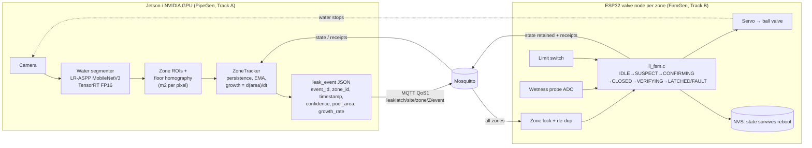
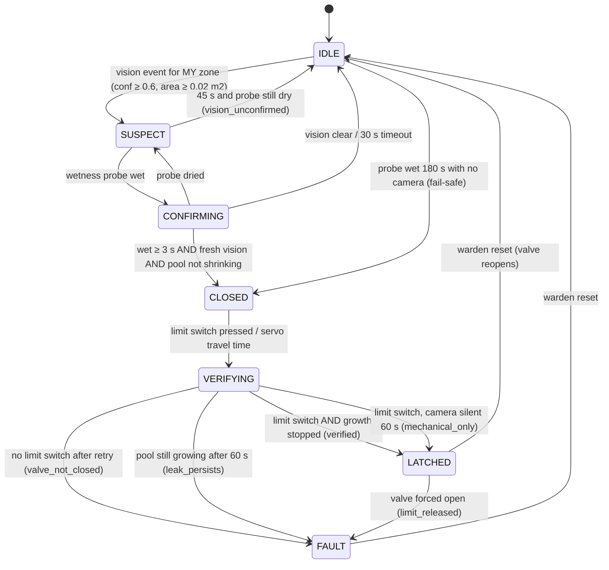

# Architecture

LeakLatch turns a camera's evidence into a physical action and then proves the action worked.
Every link in that chain is a message you can audit.

## The evidence-to-action chain

| Link | Evidence | Produced by | Message |
|---|---|---|---|
| 1. Perception | a pool of water is present, its area and growth rate | PipeGen | `leak_event` (`detect`, then `update` every 2 s) |
| 2. Local confirmation | the wetness probe at the zone's low point reads wet for 3 s | FirmGen | `receipt` SUSPECT → CONFIRMING → CLOSED |
| 3. Action | servo drives the quarter-turn valve to 90° | FirmGen | `receipt` CLOSED, `state.valve = closed` |
| 4. Mechanical proof | the closed-position limit switch is pressed | FirmGen | `receipt` CLOSED → VERIFYING (`limit_switch`) |
| 5. Hydraulic proof | the camera's `growth_rate` falls to ≤ 0.02 m2/min and stays there 5 s | PipeGen → FirmGen | `receipt` VERIFYING → LATCHED (`verified`) |

Every receipt carries `trigger_event_id`, the `event_id` of the vision event that opened the incident,
so the chain from pixels to valve is traceable. The evidence snapshot JPEG and its SHA-256 sit inside that event.

## State machine (firmgen/main/ll_fsm.c)

Design rules:

* **Zone lock.** Every node subscribes to every zone's events and rejects the ones that are not its own.
  The rejection counters are published, so a mis-addressed or spoofed event is visible, not silent.
* **Two independent senses before any action.** A camera alone never shuts water off by default; the
  vision-only override is opt-in (`LL_VISION_ONLY_AREA_CM2`). Glossy tiles, mopping and reflections
  cannot cut a hostel's water.
* **Fail closed, never fail open.** FAULT re-asserts the close command. A reboot restores LATCHED/FAULT
  from NVS. Sustained local wetness closes the valve even with the camera or network down.
* **Acknowledged incidents stay quiet.** After a reset, the leftover puddle (same `incident_id`) is ignored
  unless it grows 1.5× or the probe dries and gets wet again.
* **One owner.** A single FreeRTOS control task owns the state machine. The MQTT task only parses and queues.
* **Same code everywhere.** `ll_fsm.c` is plain C99 with no allocation and no IDF calls. It is compiled into the
  ESP32 firmware, into the host unit tests (122 checks), and into the simulator via ctypes.

## PipeGen internals

* **Segmenter:** torchvision LR-ASPP MobileNetV3-Large (3.2 M parameters, BSD-3), 320×320 input, one water channel,
  exported to ONNX opset 17 and compiled to a TensorRT FP16 engine on the target.
* **Metric area:** each zone has a polygon plus four tape-measured floor points. The homography H gives every pixel
  its true floor area `|det H| / w(x,y)^3`, so a pool at the far end of a corridor is not under-counted
  (tested: within 6 %; the naive per-pixel constant under-counts by about 30 %).
* **Growth rate:** least-squares slope of the EMA-smoothed area over the last 10 s of water frames, in m2/min.
* **Gating:** 5 consecutive water frames to `detect`, 15 dry frames to `clear`, `update` every 2 s.

## Closed-loop simulator (simlab/)

One camera watches two zones of a rendered floor: a ceramic bathroom and a Kota-stone corridor. Each zone
has its own pipe joint, servo valve with limit switch, and wetness probe. Pools are volume-based (3 mm film),
so closing a valve really stops growth, and the camera really sees that. PipeGen runs unmodified on the
rendered frames; two virtual nodes run the compiled C state machine. Every message is checked against the
JSON schemas.
